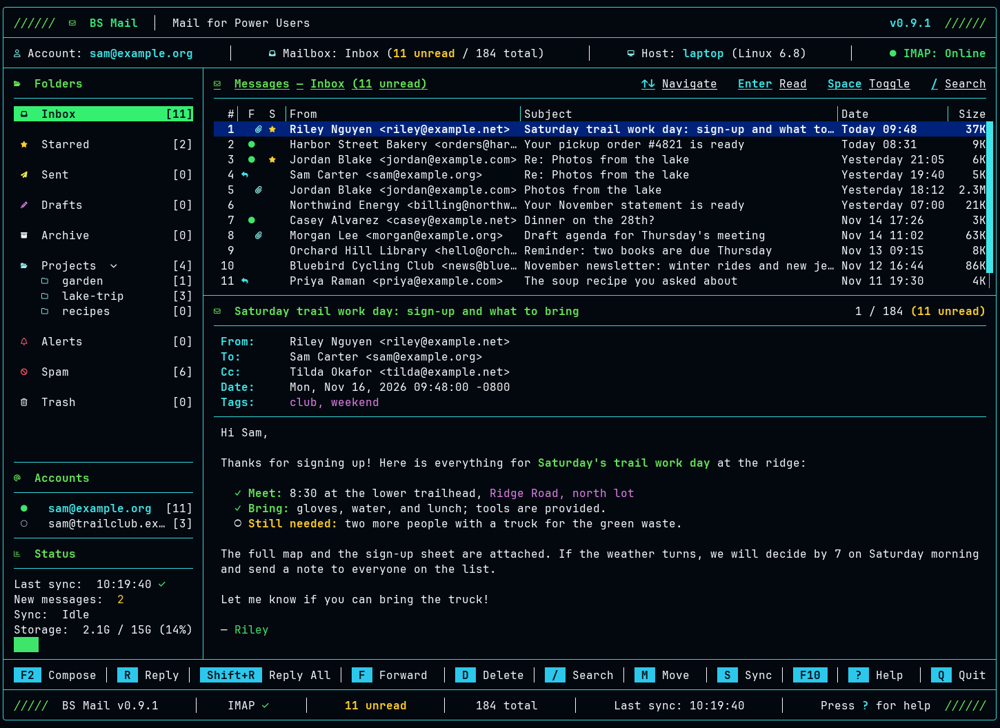
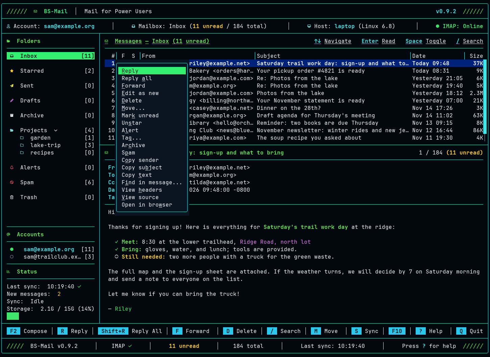

# BS-Mail

*Mail for Power Users*

A fast, keyboard-first mail client for any IMAP and SMTP account that runs in your
terminal. Everything works with the mouse too.

For Outlook, Hotmail, Microsoft 365 and other accounts that require OAuth 2.0, use an OAuth
proxy: see the [OAuth 2.0 section](#outlook-hotmail-microsoft-365-and-oauth-20) below.

## Download

Get the latest release from the [Releases page](../../releases).

| System | File |
| --- | --- |
| Linux, 64-bit (Ubuntu 22.04 or newer, and most other current distributions) | `BS-Mail_linux-x64_v0.9.3.AppImage` |
| Windows 10 or 11, 64-bit | `BS-Mail_windows-x64_v0.9.3.zip` |

Each file has a `.sha256` file beside it so you can check the download.

- **Linux:** make the file executable (`chmod +x BS-Mail_linux-x64_v0.9.3.AppImage`) and run it
  in your terminal. If it does not start, your system may need FUSE: install `libfuse2`
  (`libfuse2t64` on Ubuntu 24.04).
- **Windows:** unzip, then run `bs-mail.exe` in Windows Terminal, PowerShell or the Command
  Prompt. The program is not signed, so Windows may say "Windows protected your PC": choose
  *More info*, then *Run anyway*.

It runs in the terminal you start it from. Add `--window` to open it in a window of its own
instead, on Linux or Windows.

## First steps

1. Start BS-Mail. It opens with no account.
2. Press `F10` (or click the Options button), choose **Accounts**, then **Add account**.
3. Type your email address and pick your provider from the list: Gmail, iCloud, Yahoo,
   Fastmail, GMX, Zoho, Proton Mail Bridge, 1&1 / IONOS and many more fill in the servers
   for you. Enter your password. If your provider asks for an app password, make one in your
   account settings and use that. Outlook.com, Hotmail and Microsoft 365 do not take a
   password: they need an OAuth proxy, see
   [Outlook, Hotmail, Microsoft 365 and OAuth 2.0](#outlook-hotmail-microsoft-365-and-oauth-20).
4. Your mail appears. Press `?` for every key.

## What it does

- **Several accounts** at once, each with its own folders, switched with a click or the keyboard.
- **Read and write:** reply, reply to everyone, forward, with attachments. Pick which account
  sends, keep a signature, and complete addresses from the people you wrote to.
- **Attachments:** save them or open them. Programs and scripts are saved but never opened, and
  PDF, older Office and RTF files ask before they open.
- **HTML mail** opens as a safe copy in your browser: scripts, frames, forms and everything that
  would load from the internet are left out, and it tells you how many items were removed.
- **Find and arrange:** search, sort by any column, group into threads, tag, star and mark alerts.
  The Starred and Alerts views search the whole account. Find inside a message, and view its
  headers or the whole source.
- **Many at once:** mark several messages (`Space`, Ctrl or Shift click) and delete, move, tag,
  mark read, star or archive them together. Delete always asks first.
- **Folders:** make, rename and delete them, mark all read, empty the Trash or Spam.
- **Keyboard first:** read a whole mailbox with `Space` and `N`, jump to any folder with `g` `g`,
  and step through the links of a message with `l`. The pane that has the keys is marked in its title.
- **Mouse too:** right-click menus, drag messages onto a folder, click links and addresses, select
  and copy text.
- **Make it yours:** layout and panels in Options, any key rebound in `config.toml`, your own themes.

## Keys to start with

| Key | Does |
| --- | --- |
| `j` `k` or arrows | move |
| `Enter`, `Esc` | go in, come back out |
| `Tab`, `1` `2` `3` | folders, message list, open message |
| `c` | write a message |
| `r`, `R`, `f` | reply, reply to everyone, forward |
| `d` | delete (asks first) |
| `Space` | in the list: mark a message, then act on all marked |
| `Space` | in the open message: page down, then on to the next unread message |
| `n`, `p`, `N` | next message, previous message, next unread (in the next folder with unread mail when this one is done) |
| `g` `g` | go to any folder by typing its name |
| `l`, `L` | choose the next or previous link in the message; `Enter` opens it, `.` shows its menu |
| `/` | search |
| `o`, `O`, `T` | sort, reverse the sort, threads on or off |
| `t` | tag |
| `.` or right-click | the menu |
| `F10` | options |
| `?` | all keys |

## Your data and privacy

- Everything BS-Mail keeps is in one folder and nowhere else: the `data` folder next to the
  program on Windows, and `~/.bs-mail` for the Linux AppImage. Mail itself is not stored on
  your computer; it is read from the server when you open it.
- It talks only to the mail servers you set up (over TLS; or, if you use an OAuth proxy on your
  own computer, to that proxy without encryption, which never leaves the computer), to your
  provider's sign-in page if you use the browser sign-in, and to your browser for links you
  click. It sends nothing to its author: no usage figures, no crash reports, no update checks,
  and it never loads remote images from messages.
- Passwords, sign-in tokens and saved client secrets are kept encrypted in a vault in that
  folder. You choose how it is protected in Options: a key file in the folder (the default:
  nothing to type and the folder stays portable, but anyone who gets the whole folder can
  read it), a passphrase you type at start, or the system keychain on Windows and Linux
  (nothing to type, and a copy of the folder is useless on another computer). Windows does not
  keep other people who use the same PC out of that folder by itself, so on a shared Windows PC
  choose the system keychain (Options moves your saved secrets over for you).
- To remove everything, delete the program and that folder. If you used the system keychain,
  switch to another way in Options first, so its key is removed too.

## Outlook, Hotmail, Microsoft 365 and OAuth 2.0

Outlook.com, Hotmail, Live and Microsoft 365 no longer accept a password from any mail program:
they need OAuth 2.0 sign-in, and so do some other providers. Gmail takes OAuth 2.0 or an app
password, and the app password is much simpler (turn on two-step verification, make an app
password, and enter it as your password). For OAuth, use an OAuth proxy. BS-Mail can also sign
in through your web browser by itself, but that is new and less tried; see
[Sign in through your web browser](#sign-in-through-your-web-browser).

### Use an OAuth proxy

An external IMAP and SMTP OAuth proxy signs in to your provider for you, so BS-Mail keeps using
standard IMAP and SMTP. Options:

* [Email OAuth2 Proxy](https://github.com/simonrob/email-oauth2-proxy): free, open-source proxy
  that runs locally on Windows, Linux or macOS. Supports IMAP, POP3 and SMTP. It handles OAuth
  authentication transparently, using your own OAuth application registration or, where
  permitted, an existing registered client ID (see [Making a client ID](#making-a-client-id)).
* [Auth-Email](https://auth-email.com/): hosted, managed OAuth proxy service with a free trial
  and paid plans. No local proxy installation or OAuth application registration required.
  Supports Outlook, Microsoft 365, Gmail, Yahoo and other providers.

Set up your account in the proxy and authorize access through your provider's secure login.
Then add the account in BS-Mail:

1. Type your email address and set **Sign in with** to password.
2. Open **Account settings**. Set **Incoming server** to `127.0.0.1` with the proxy's IMAP port
   and **Outgoing server** to `127.0.0.1` with its SMTP port (the Email OAuth2 Proxy's sample
   setup uses 1993 and 1587), and set both securities to *not encrypted (this machine only)*.
3. Enter your address as the user name, and any password you make up. It is not your real
   password: the proxy uses it to keep its saved sign-in safe, so always use the same one.

BS-Mail allows an unencrypted connection only to your own computer, so a local proxy must run
on the same machine; the proxy itself talks to your provider over TLS. The proxy keeps its saved
sign-in in its own settings file, so keep that file private. For a hosted service, use the
server names and ports it gives you, with normal encryption.

Note: these are optional third-party solutions, not bundled with this application. Local
proxies offer greater control over your mail traffic, while hosted services provide simpler
setup but require trusting an external provider with your email connection.

### Sign in through your web browser

BS-Mail has no client ID of its own, because only the owner of a Microsoft or Google account
can register one, so you make one first ([Making a client ID](#making-a-client-id)). Then add
the account, leave **Sign in with** on *your web browser (OAuth2)* and press **Sign in and
save**. BS-Mail opens the provider's page for making a client ID if you have none, waits for you
to paste it into **Client id**, and then opens the provider's sign-in page in your browser. The
client ID is kept, so later accounts of that provider need no new one.

This sign-in is new: it has been tried against a stand-in provider, not yet against a real
Microsoft or Google account. If it gives you trouble, use a proxy.

### Making a client ID

A client ID says which program is asking; it is not a password. You make one once, free, under
your own account. The browser sign-in needs one, and so does a local proxy; a hosted proxy does
not.

- **Microsoft** (Entra admin center, App registrations, New registration): accounts in any
  organizational directory and personal Microsoft accounts; redirect URI of type *Mobile and
  desktop applications* set to `http://localhost`; under Authentication, turn on *Allow public
  client flows*; under API permissions add the delegated permissions `IMAP.AccessAsUser.All`,
  `SMTP.Send` and `offline_access` of Office 365 Exchange Online; copy the Application (client)
  ID. No client secret is needed. Outlook.com must have IMAP switched on in its settings, and a
  work or school account may need an administrator to allow it.
- **Google** (Cloud console): set up the OAuth consent screen (External, your own address as a
  test user), add the scope `https://mail.google.com/`, then create an OAuth client ID of type
  *Desktop app* and copy both the client ID and the client secret. Google shows a "hasn't
  verified this app" page for it.

## Licence

BS-Mail is not open source. It is free for your own personal, non-commercial use. You may not
copy or share it, change it, sell it, or use it commercially without written permission. See
[LICENSE](LICENSE). The fonts and libraries it uses keep their own licenses, which come with
each download in the file `NOTICE`.
