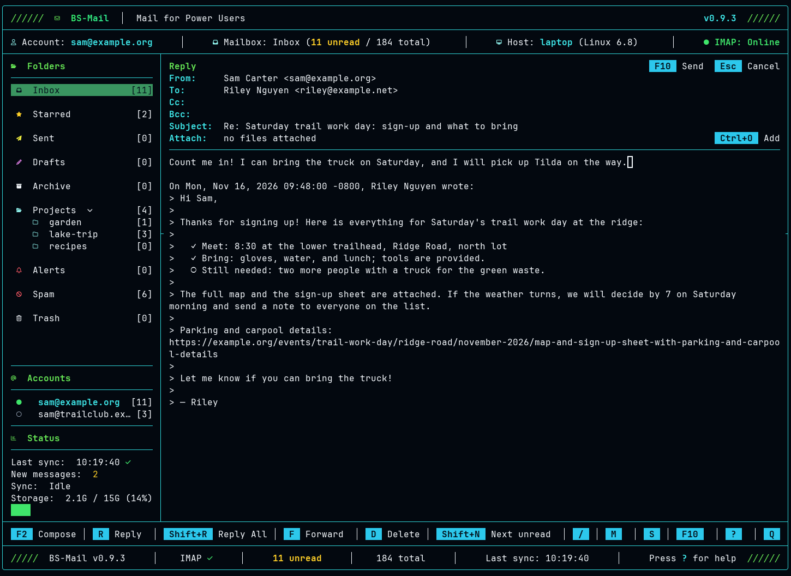

# BS-Mail

*Mail for Power Users*

A fast, keyboard-first mail client for any IMAP and SMTP account that runs in your
terminal. Everything works with the mouse too.

## Download

Get the latest release from the [Releases page](../../releases).

| System | File |
| --- | --- |
| Linux, 64-bit (Ubuntu 22.04 or newer, and most other current distributions) | `BS-Mail_linux-x64_v0.9.3.AppImage` |
| Windows 10 or 11, 64-bit | `BS-Mail_windows-x64_v0.9.3.zip` |

Each file has a `.sha256` file beside it so you can check the download.

- **Linux:** make the file executable (`chmod +x BS-Mail_linux-x64_v0.9.3.AppImage`) and run it
  in your terminal. If it does not start, your system may need FUSE: install `libfuse2`
  (`libfuse2t64` on Ubuntu 24.04).
- **Windows:** unzip, then run `bs-mail.exe` in Windows Terminal, PowerShell or the Command
  Prompt. The program is not signed, so Windows may say "Windows protected your PC": choose
  *More info*, then *Run anyway*.

It runs in the terminal you start it from. Add `--window` to open it in a window of its own
instead, on Linux or Windows.

## First steps

1. Start BS-Mail. It opens with no account.
2. Press `F10` (or click the Options button), choose **Accounts**, then **Add account**.
3. Type your email address and pick your provider from the list: Gmail, Outlook, iCloud,
   Yahoo, Fastmail, GMX, Zoho, Proton Mail Bridge, 1&1 / IONOS and many more fill in the
   servers for you. Enter your password. If your provider asks for an app password, make
   one in your account settings and use that.
4. Your mail appears. Press `?` for every key.

Signing in through your web browser (OAuth2) is there too, for providers that offer it;
it needs a client ID that you make once with the provider.

## What it does

- **Several accounts** at once, each with its own folders, switched with a click or the keyboard.
- **Read and write:** reply, reply to everyone, forward, with attachments. Pick which account
  sends, keep a signature, and complete addresses from the people you wrote to.
- **Attachments:** save them or open them. Programs and scripts are saved but never opened.
- **HTML mail** opens as a safe copy in your browser: scripts, frames, forms and everything that
  would load from the internet are left out, and it tells you how many items were removed.
- **Find and arrange:** search, sort by any column, group into threads, tag, star and mark alerts.
  The Starred and Alerts views search the whole account.
- **Many at once:** mark several messages (`Space`, Ctrl or Shift click) and delete, move, tag,
  mark read, star or archive them together. Delete always asks first.
- **Folders:** make, rename and delete them, mark all read, empty the Trash or Spam.
- **Keyboard first:** read a whole mailbox with `Space` and `N`, jump to any folder with `g` `g`,
  and step through the links of a message with `l`. The pane that has the keys is marked in its title.
- **Mouse and keyboard:** right-click menus, drag messages onto a folder, click links and addresses,
  select and copy text, find inside a message, view the headers or the whole source.
- **Make it yours:** layout and panels in Options, any key rebound in `config.toml`, your own themes.

## Keys to start with

| Key | Does |
| --- | --- |
| `j` `k` or arrows | move |
| `Enter`, `Esc` | go in, come back out |
| `Tab`, `1` `2` `3` | folders, message list, open message |
| `c` | write a message |
| `r`, `R`, `f` | reply, reply to everyone, forward |
| `d` | delete (asks first) |
| `Space` | in the list: mark a message, then act on all marked |
| `Space` | in the open message: page down, then on to the next unread message |
| `n`, `p`, `N` | next message, previous message, next unread (in the next folder with unread mail when this one is done) |
| `g` `g` | go to any folder by typing its name |
| `l`, `L` | choose the next or previous link in the message; `Enter` opens it, `.` shows its menu |
| `/` | search |
| `o`, `O`, `T` | sort, reverse the sort, threads on or off |
| `t` | tag |
| `.` or right-click | the menu |
| `F10` | options |
| `?` | all keys |

## Your data and privacy

- Everything BS-Mail keeps is in one folder and nowhere else: the `data` folder next to the
  program on Windows, and `~/.bs-mail` for the Linux AppImage. Mail itself is not stored on
  your computer; it is read from the server when you open it.
- It talks only to the mail servers you set up (over TLS), to your provider's sign-in page if
  you use the browser sign-in, and to your browser for links you click. It sends nothing to
  its author: no usage figures, no crash reports, no update checks, and it never loads remote
  images from messages.
- Passwords, sign-in tokens and saved client secrets are kept encrypted in a vault in that
  folder. You choose how it is protected in Options: a key file in the folder (the default:
  nothing to type and the folder stays portable, but anyone who gets the whole folder can
  read it), a passphrase you type at start, or the system keychain on Windows and Linux
  (nothing to type, and a copy of the folder is useless on another computer).
- To remove everything, delete the program and that folder. If you used the system keychain,
  switch to another way in Options first, so its key is removed too.

## Licence

BS-Mail is not open source. It is free for your own personal, non-commercial use. You may not
copy or share it, change it, sell it, or use it commercially without written permission. See
[LICENSE](LICENSE). The fonts and libraries it uses keep their own licenses, which come with
each download in the file `NOTICE`.
